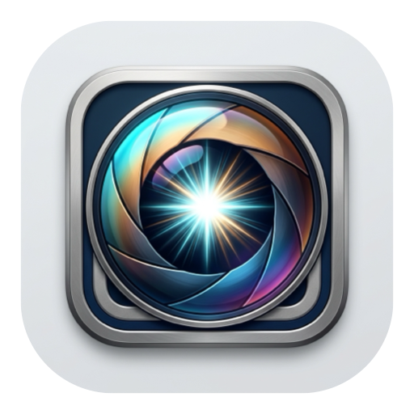

<div align="center">



# 📸 WinGlance 1.7 for Windows 11 ⚡

### The ultra-fast, native DirectX 11 & Direct2D 1.3 HDR photo viewer & pro culling tool 🚀  
*Instant full-screen folder browsing, zero-latency traversal, 16-bit RAW demosaicing, AI Burst & Face Vision, 4-UP compare, Filmstrip & RAW Film Profiles.*

[](https://github.com/garrul4ik/winglance/releases/latest)
[](https://github.com/garrul4ik/winglance)
[](https://github.com/garrul4ik/winglance)
[](https://github.com/garrul4ik/winglance)
[](https://github.com/garrul4ik/winglance)
[](https://github.com/mortalezz/glance)
[](https://github.com/garrul4ik/winglance)
[](LICENSE)

</div>

---

> [!NOTE]
> ### 🕊️ Standalone Windows Port of Glance for macOS
> **WinGlance** is an open-source Windows 11 standalone port of [**Glance**](https://github.com/mortalezz/glance), originally designed and created for macOS by [**@mortalezz**](https://github.com/mortalezz).
>
> **WinGlance 1.7** brings full feature parity with Glance on Windows 11 through a zero-bloat monolithic native architecture:
> 1. 🖼️ **Native Direct3D 11.1 & Direct2D 1.3 HDR Pipeline**: Flip-Model swapchain running in 16-bit floating-point linear scRGB (`R16G16B16A16_FLOAT`) for Wide Color Gamut (Display P3, Adobe RGB, ProPhoto RGB) and HDR monitors, falling back cleanly to sRGB.
> 2. ⚡ **Zero-Copy Memory-Mapped RAW Previews + 16-bit LibRaw Demosaicing**: Bundled monolithic `LibRaw` (1,182 camera models, zero external codecs) with instant zero-copy previews for Sony `.ARW`, Canon `.CR2`/`.CR3`, Nikon `.NEF`, Fujifilm `.RAF`, Panasonic `.RW2`, Olympus `.ORF`, Pentax `.PEF`, and true 16-bit demosaicing on 1:1 zoom.
> 3. 🫧 **Real Frosted-Glass Vibrancy HUDs & Dual Themes (`T` / `D`)**: Real-time `CLSID_D2D1GaussianBlur` glassmorphic cards adapting dynamically between Frosted Dark and Frosted Light Windows themes.
> 4. 🧠 **On-Device AI Burst & Face Vision (`Shift + Z`, `A`, `B`, `Shift + P`)**: DirectML GPU/NPU YuNet face & eye detection (Eye Jump + Face Verification Dock), DCT pHash + HSV scene clustering, AI Sharpness/Exposure Burst Hero 👑 ranking, and single-key Burst Knockout.
> 5. 🪶 **NativeAOT Single-File Binary (10.8 MB)**: Zero WPF, compiled into a self-contained portable `.exe` with original Glance multi-resolution icon.

---

## ⚡ Key Features

| Feature | Highlight |
| :--- | :--- |
| 🎮 **Direct3D 11.1 + Direct2D 1.3 HDR/WCG Engine** | DXGI Flip-Model SwapChain (`R16G16B16A16_FLOAT` HDR16 / `B8G8R8A8_UNorm` sRGB) with hardware ICC color management. |
| 🧠 **Burst Hero 👑 & Scene Intelligence (`[` / `]` / `B` / `Shift+P`)** | Pure-native DCT pHash + HSV histogram + EXIF sub-second clustering, top-20% Laplacian sharpness + YuNet eye sharpness Hero selection, and atomic **Burst Knockout**. |
| 👥 **Multi-Up `1-UP → 2-UP → 4-UP` (`S` / `Tab`)** | Rounded 2-UP & 4-UP grid with per-pane frosted badges, hover/Tab slot selection, **2-UP King of the Hill (`1` / `2`)**, and **4-UP Solo 1:1 Loupe (`Z`)**. |
| 🧑 **Face Verification Dock (`A`)** | Floating dock of YuNet face crops (`128×128`) with eye focus `✓ SHARP` / `~ SOFT` indicators; click any face to zoom 100% straight to the eye. |
| 🎞️ **Virtualized Filmstrip Scrubber (`G` / Bottom Hover)** | 160 px async thumbnail ring buffer with inertial horizontal wheel scrolling, Pick/Reject/Star/Color badges, 👑 Hero marks, and burst brackets. |
| 🎨 **RAW Film Simulations & Camera Profiles (`V`)** | GPU `ColorMatrix` 5×4 picture controls for **Fujifilm** (Provia, Velvia, Astia, Classic Chrome, Acros, Classic Neg), **Nikon**, and **Sony** RAWs, synced via `crs:CameraProfile`. |
| 👁️ **AI Auto Eye Jump (`Shift + Z` / Mid-Click / Double-Tap `Z`)** | Instant hardware-accelerated zoom to the sharpest detected eye across multiple faces. |
| 🔬 **Optical Reticle Loupe (`M`) & Spring-Loaded Zoom (`Hold Z`)** | Circular 2× / 4× optical magnifier barrel following the cursor; hold `Z` to glide at 1:1 and release back to Fit, plus interactive **1:1 Navigator Mini-Map**. |
| 🌈 **ARRI False Color (`Shift + O`), Blinkies (`O`), Focus Peaking (`Shift + F`), Histogram (`H`)** | 7-band IRE exposure false color map + legend, pulsing shadow/highlight clipping blinkies, Sobel neon peaking, and dual 2-UP histograms. |
| 🏷️ **100-Step Undo/Redo, Live Watcher, XMP & Recycle Bin** | Non-destructive Adobe XMP sidecars, 100-level Undo/Redo (`Ctrl+Z` / `Ctrl+Shift+Z`) including Windows Recycle Bin restoration, auto-advance (`C`), smart filters (`\` / `Shift+\`), `./Selects` export (`E` / `Shift+E`), and external editor launch (`Ctrl+Enter`). |

---

## ⌨️ Complete Keyboard Shortcuts Cheatsheet

Press **`?`** or **`F1`** at any time inside WinGlance to toggle the interactive frosted-glass cheatsheet (**`Space`** expands all 4 categories).

### 🏷️ Culling, Multi-Up & Burst AI
| Key | Action | Description |
| :---: | :--- | :--- |
| **`P`** / **`X`** / **`U`** | **Pick / Reject / Unflag** | Flag active photo (or active Multi-Up pane) as Pick, Reject, or Unflagged |
| **`B`** / **`Shift + P`** | **Burst Hero 👑 / Knockout** | Jump to AI Hero of current burst (`B`) or Pick Hero & Reject burst siblings atomically (`Shift+P`) |
| **`1` – `5`** / **`0`** | **Star Rating ⭐ / Clear** | Rates active photo `★`–`★★★★★` (in **2-UP**, `1` / `2` triggers **King of the Hill**) |
| **`6` – `9`** | **Color Labels 🎨** | `6`: Red 🟥 &nbsp; `7`: Yellow 🟨 &nbsp; `8`: Green 🟩 &nbsp; `9`: Blue 🟦 |
| **`C`** | **Auto-Advance ⚡** | Toggle automatic advance after flagging/rating |
| **`\`** / **`Shift + \`** / **`Ctrl+F`** | **Smart Filters 🔀** | Cycle populated filters (`All`, `Picks`, `Hide Rejects`, `Stars`, `Colors`) / quick toggle `Picks Only` |
| **`S`** / **`Tab`** | **Multi-Up `1→2→4` / Switch** | Cycle `1-UP` / `2-UP` / `4-UP` compare mode (`Tab` or hover selects active cell) |
| **`Ctrl + Z`** / **`Ctrl + Shift + Z`** | **Undo / Redo ↩️** | Multi-level Undo/Redo (100 steps) across ratings, flags, profiles, rotations & Recycle Bin deletes |

### 🔍 Zoom, Focus & Face Inspection
| Key | Action | Description |
| :---: | :--- | :--- |
| **`Hold Z`** / **`Z`** / **Right-Click** | **Spring-Loaded / 100% 1:1 Zoom** | Hold to peek & glide, tap to toggle 1:1 (16-bit LibRaw); in 4-UP opens Solo 1:1 Loupe |
| **`Shift + Z`** / **Mid-Click** / **`2×Z`** | **AI Auto Eye Jump 👁️** | Jump directly to the sharpest eye (DirectML YuNet); repeat to cycle across faces |
| **`A`** | **Face Verification Dock 👥** | Toggle bottom dock of face crops with sharpness indicator; click tile to jump 1:1 to eye |
| **`M`** / **Click** | **Optical Reticle Loupe 🔬** | Floating machined 2× / 4× loupe at cursor (cycles 2× ↔ 4× on click) |
| **`Shift + F`** | **GPU Focus Peaking 🎯** | Toggle real-time Sobel neon emerald in-focus overlay |
| **`Wheel`** / **`Ctrl + Wheel`** | **Zoom / Filmstrip Scroll** | Cursor-anchored zoom (or scroll thumbnails when hovering Filmstrip) |

### 📊 Exposure, Camera Profiles & Theme
| Key | Action | Description |
| :---: | :--- | :--- |
| **`H`** | **RGB Histogram 📊** | Live 256-bin additive RGB & Rec. 709 Luminance histogram (dual card in 2-UP) |
| **`O`** / **`Shift + O`** | **Blinkies / ARRI False Color 🌈** | Pulsing highlight/shadow clipping (`O`) or 7-band IRE False Color + legend (`Shift+O`) |
| **`V`** | **RAW Film Profile 🎨** | Cycle brand-tailored Fujifilm / Nikon / Sony RAW picture controls & film simulations |
| **`I`** | **EXIF Dossier 📷** | Toggle metadata HUD card (hover expands details; click copies technical summary) |
| **`T`** / **`D`** | **Light / Dark Glass Theme 🌓** | Switch Frosted Dark / Frosted Light glass UI theme (persisted) |

### 🧭 Navigation, Filmstrip & Workflow
| Key | Action | Description |
| :---: | :--- | :--- |
| **`→`**, **`↓`**, **`Space`**, **`PgDn`**, **`J`**, **`N`** | **Next Photo ⏩** | Advance to next photo (or next block of N in Multi-Up) |
| **`←`**, **`↑`**, **`PgUp`**, **`K`** | **Previous Photo ⏪** | Go to previous photo |
| **`]`** / **`[`**, **`Ctrl + →`** / **`Ctrl + ←`** | **Next / Prev Scene Leap ⚡** | Jump cleanly across perceptual & temporal scene boundaries |
| **`Home`** / **`End`** | **First / Last Photo 🏁** | Jump to start or end of active playlist |
| **`G`** / **Bottom Edge Hover** | **Filmstrip Scrubber 🎞️** | Pin/unpin virtualized thumbnail strip with `WM_MOUSEHWHEEL` inertial scroll |
| **`Enter`** / **`+`** **`-`** | **Slideshow 📽️** | Play/pause automated slideshow and adjust interval (`1–30s`) |
| **`R`** / **`L`** | **Lossless Rotate ↻ / ↺** | Lossless EXIF + XMP 90° CW / CCW orientation rotation |
| **`E`** / **`Shift + E`** | **Export to `./Selects` 📦** | Export active photo (`E`) or all flagged Picks (`Shift+E`) with companion RAW/XMP |
| **`Ctrl + Enter`** | **External Editor 🛠️** | Open active RAW/photo in Windows associated external editor |
| **`Del`** / **`Shift + Del`** | **Trash / Purge Rejects 🗑️** | Move active photo or all Rejected (`X`) photos to Windows Recycle Bin (Undoable!) |
| **`Ctrl + O`** / **`F`** / **`F11`** / **`Esc`** | **Open / Fullscreen / Back** | Browse folder/file, toggle Fullscreen, or cascade-dismiss overlays & zoom |

---

## 🚀 Download & Installation

### Option 1: Direct Download (Portable Standalone) 📦
Download the pre-compiled standalone binary from the [**Releases Page**](https://github.com/garrul4ik/winglance/releases/latest):
1. Download **`WinGlance-v1.7.0-Windows-x64.zip`** (or `WinGlance.exe`).
2. Run `WinGlance.exe` anywhere — completely portable, single file (10.8 MB), zero installer, zero dependencies.
3. Drag any image or photo folder onto `WinGlance.exe` or set it as default in Windows Explorer!

### Option 2: Build from Source (NativeAOT) 🛠️
```powershell
# Clone the repository
git clone https://github.com/garrul4ik/winglance.git
cd winglance

# Run full test suite (46 tests)
dotnet test -c Release

# Publish NativeAOT single-file standalone executable (~10.8 MB)
dotnet publish src/WinGlance/WinGlance.csproj -c Release -r win-x64 -p:PublishAot=true -o publish/win-x64
```

---

## 🤝 Credits & Acknowledgements

- **Original Project & Concept**: [mortalezz/glance](https://github.com/mortalezz/glance) by [**@mortalezz**](https://github.com/mortalezz). All UI design patterns, keyboard shortcuts, and Phoenix Slides revival philosophies originate from Glance for macOS.
- **Windows Standalone Port (WinGlance 1.7)**: Developed for Windows 11 by [**@garrul4ik**](https://github.com/garrul4ik) with Direct3D 11, Direct2D 1.3 HDR, LibRaw, and DirectML AI Vision.

---

## 📄 License ⚖️

WinGlance is open-source software licensed under the [MIT License](LICENSE).
