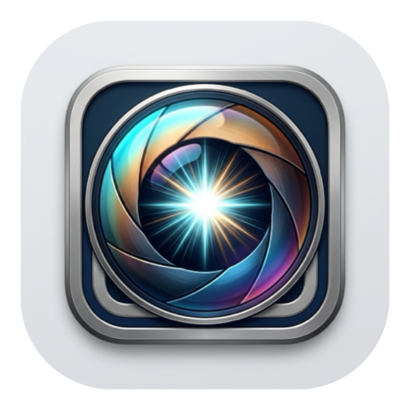

<div align="center">



# 📸 WinGlance 2.0 for Windows 11 ⚡

### The ultra-fast, native DirectX 11 & Direct2D 1.3 HDR photo viewer & pro culling tool 🚀  
*Instant full-screen folder browsing, zero-latency traversal, 16-bit RAW demosaicing, and on-device DirectML AI Vision.*

[](https://github.com/garrul4ik/winglance/releases/latest)
[](https://github.com/garrul4ik/winglance)
[](https://github.com/garrul4ik/winglance)
[](https://github.com/garrul4ik/winglance)
[](https://github.com/garrul4ik/winglance)
[](https://github.com/mortalezz/glance)
[](https://github.com/garrul4ik/winglance)
[](LICENSE)

</div>

---

> [!NOTE]
> ### 🕊️ Standalone Windows Port of Glance for macOS
> **WinGlance** is an open-source Windows 11 standalone port of [**Glance**](https://github.com/mortalezz/glance), originally designed and created for macOS by [**@mortalezz**](https://github.com/mortalezz).
>
> WinGlance 2.0 completely re-architects the graphics and vision pipeline to deliver an Apple Metal / Vision-grade monolithic experience natively on Windows 11:
> 1. 🖼️ **Native Direct3D 11.1 & Direct2D 1.3 HDR Pipeline**: Flip-Model swapchain running in 16-bit floating-point linear scRGB (`R16G16B16A16_FLOAT`) for Wide Color Gamut (Display P3, Adobe RGB, ProPhoto RGB) and HDR monitors, falling back cleanly to sRGB.
> 2. ⚡ **Zero-Copy Memory-Mapped RAW Previews + 16-bit LibRaw Demosaicing**: Bundled monolithic `LibRaw` (1,182 camera models supported, zero Microsoft Store codec dependencies) with instant zero-copy previews for Sony `.ARW`, Canon `.CR2`/`.CR3` (`PRVW`), Nikon `.NEF`, Fujifilm `.RAF`, Panasonic `.RW2`, Olympus `.ORF`, Pentax `.PEF`, and true 16-bit sensor demosaicing on 1:1 zoom.
> 3. 🫧 **Real Within-Window Frosted-Glass Vibrancy HUDs**: Real-time `CLSID_D2D1GaussianBlur` shaders blur the photo beneath rounded squircle HUD cards and modals.
> 4. 👁️ **On-Device GPU/NPU AI Vision (`Shift + Z`)**: Instant Auto Face & Eye Jump powered by Windows 11's built-in `System32\onnxruntime.dll` + DirectML (NPU/GPU) and embedded YuNet landmark model.
> 5. 🪶 **NativeAOT Single-File Binary (9.6 MB)**: Zero WPF, zero DirectX 9 legacy baggage, compiled into a single portable `.exe` with original Glance multi-resolution icon.

---

## ⚡ Key Features

| Feature | Highlight |
| :--- | :--- |
| 🎮 **Direct3D 11.1 + Direct2D 1.3 HDR/WCG Engine** | DXGI 1.6 Flip-Model SwapChain with FP16 linear scRGB (`R16G16B16A16_FLOAT`). Direct2D hardware ICC color management for Display P3, Adobe RGB, and ProPhoto RGB. |
| 👁️ **AI Auto Face & Eye Jump (`Shift + Z` / Double-Tap `Z`)** | Instant hardware-accelerated jump to the sharpest eye at 100%+ zoom. Cycles across multiple faces and eyes on repeat presses. |
| 🎯 **GPU Focus Peaking (`Shift + F`)** | Real-time Sobel edge detection and neon emerald shader highlights in-focus eyelashes and textures at 120 FPS. |
| 🔬 **Monolithic 16-Bit RAW Demosaicing (`Z`)** | Bundled `LibRaw` (1,182 cameras) provides zero-copy preview extraction and true 16-bit sensor demosaicing without any third-party codecs. |
| 🔍 **100% 1:1 Sensor Zoom (`Z` / Click)** | Bounded HighQualityCubic scaling when fitting, instantly switching to crisp NearestNeighbor pixel grid when peeping $\ge 200\%$. |
| 👥 **2-Up Burst Compare (`S` / `Tab`)** | Side-by-side split comparison to catch micro-blur and focus differences, with synchronous panning and zoom across both panes. |
| 🏷️ **Adobe XMP Sidecar Synchronization** | Real-time, non-destructive rating (`★`), color tagging, and flag management fully compatible with **Adobe Lightroom Classic, Capture One, Darktable, and Photo Mechanic**. |
| 📊 **Live RGB & Luminance Histogram (`H`)** | 256-bin additive RGB curves rendered in real time with Rec. 709 luminance weighting. |
| 🚨 **Exposure Clipping Warnings / "Blinkies" (`O`)** | Pulsating 60 FPS zebra overlay for blown highlights (Red) and crushed shadows (Blue), supporting 16-bit precision buffers. |
| 🔄 **Lossless EXIF Rotation (`R` / `]` and `L` / `[` )** | Losslessly updates embedded JPEG/TIFF EXIF orientation tag (`0x0112`) without touching compressed DCT scan data, syncing `.xmp` sidecars in tandem. |
| 📦 **One-Key Quick Export (`Ctrl + E`)** | Copies all flagged Picks and companion sidecars to `./Picks`. |
| 🗑️ **Safe Recycle Bin & Batch Purge (`Del` / `Shift + Del`)** | Safely send active photo or all rejected photos to Windows Recycle Bin with confirmation. |
| 🪶 **Single Portable Executable (9.6 MB)** | Compiled with .NET 8 NativeAOT into one portable file with zero installers and zero companion DLLs. |

---

## ⌨️ Complete Keyboard Shortcuts Cheatsheet

Press **`?`** or **`F1`** at any time inside WinGlance to toggle the interactive frosted-glass shortcuts cheatsheet.

### 🏷️ Culling & Rating
| Key | Action | Description |
| :---: | :--- | :--- |
| **`P`** | **Pick / Flag 🟢** | Mark photo as a keeper with vibrant green badge |
| **`X`** | **Reject 🔴** | Mark photo as a reject for deletion |
| **`U`** | **Unflag ⚪** | Clear pick / reject status to neutral |
| **`1` – `5`** | **Star Rating ⭐** | Rates image `★` to `★★★★★` (vibrant gold) |
| **`0`** | **Clear Rating ✖️** | Clears star rating |
| **`6` – `9`** | **Color Labels 🎨** | `6`: Red 🟥 &nbsp; `7`: Yellow 🟨 &nbsp; `8`: Green 🟩 &nbsp; `9`: Blue 🟦 |
| **`Ctrl + F`** | **Cycle Filters 🔀** | Cycles: `All` ➔ `Picks Only` ➔ `Hide Rejects` ➔ `Rejects Only` ➔ `Unrated` ➔ `3+ Stars` ➔ `5 Stars` |

### 🔍 Review, Focus & AI Vision
| Key | Action | Description |
| :---: | :--- | :--- |
| **`Z`** / **Click** | **100% 1:1 Sensor Zoom 🔍** | Zoom to 1:1 sensor pixels (upgrades RAW to 16-bit LibRaw demosaic) |
| **`Shift + Z`** | **AI Auto Eye Jump 👁️** | Jump directly to the sharpest eye (DirectML GPU/NPU); repeat to cycle eyes |
| **`Shift + F`** | **GPU Focus Peaking 🎯** | Toggle real-time Sobel neon emerald in-focus overlay |
| **`S`** / **`Tab`** | **2-Up Split Compare 👥** | Side-by-side comparison with synchronous zoom & pan (`Tab` swaps active pane) |

### 📊 Exposure & Information Overlays
| Key | Action | Description |
| :---: | :--- | :--- |
| **`H`** | **RGB Histogram 📊** | Live 256-bin additive RGB & Rec. 709 Luminance histogram card |
| **`O`** | **Exposure Clipping 🚨** | Pulsing highlight (Red) and shadow (Blue) "blinkies" |
| **`?`** / **`F1`** | **Cheatsheet 💡** | Toggle frosted-glass shortcuts modal |

### 🛠️ Workflow & Output
| Key | Action | Description |
| :---: | :--- | :--- |
| **`R`** or **`]`** | **Rotate CW ↷** | Lossless 90° clockwise EXIF & XMP rotation |
| **`L`** or **`[`** | **Rotate CCW ↶** | Lossless 90° counter-clockwise EXIF & XMP rotation |
| **`Ctrl + E`** | **Quick Export 📦** | Copies all Picks to `./Picks` folder |
| **`Space`** | **Slideshow 📽️** | Start/stop automated hands-free slideshow (`[` / `]` changes speed 1s–15s) |
| **`Delete`** / **`Backspace`** | **Trash 🗑️** | Move active file (and RAW/JPEG pair + XMP) to Windows Recycle Bin |
| **`Shift + Delete`** | **Purge Rejects 🗑️** | Batch move all Rejected (`X`) photos in folder to Recycle Bin |
| **`Ctrl + O`** | **Open Folder / File 📂** | Browse file or folder |

### 🧭 Navigation
| Key | Action |
| :---: | :--- |
| **`→`**, **`↓`**, **`Page Down`**, **`J`** | Next image ⏩ |
| **`←`**, **`↑`**, **`Page Up`**, **`K`** | Previous image ⏪ |
| **`Home`** / **`End`** | First / Last image in folder 🏁 |
| **`F`** / **`F11`** | Toggle Full Screen / Dark Windowed mode ⛶ |
| **`Esc`** | Close cheatsheet / reset zoom / exit ✕ |

---

## 🚀 Download & Installation

### Option 1: Direct Download (Portable Standalone) 📦
Download the pre-compiled standalone binary from the [**Releases Page**](https://github.com/garrul4ik/winglance/releases/latest):
1. Download **`WinGlance-v2.0.0-Windows-x64.zip`** (or `WinGlance.exe`).
2. Run `WinGlance.exe` anywhere — completely portable, single file (9.6 MB), zero installer, zero dependencies.
3. Drag any image or photo folder onto `WinGlance.exe` or set it as default in Windows Explorer!

### Option 2: Build from Source (NativeAOT) 🛠️
```powershell
# Clone the repository
git clone https://github.com/garrul4ik/winglance.git
cd winglance

# Run test suite (100% pass)
dotnet test -c Release

# Publish NativeAOT single-file standalone executable (~9.6 MB)
dotnet publish src/WinGlance/WinGlance.csproj -c Release -r win-x64 -p:PublishAot=true -o publish/win-x64
```

---

## 🤝 Credits & Acknowledgements

- **Original Project & Concept**: [mortalezz/glance](https://github.com/mortalezz/glance) by [**@mortalezz**](https://github.com/mortalezz). All UI design patterns, keyboard shortcuts, and Phoenix Slides revival philosophies originate from Glance for macOS.
- **Windows Standalone Port (WinGlance 2.0)**: Developed for Windows 11 by [**@garrul4ik**](https://github.com/garrul4ik) with Direct3D 11, Direct2D 1.3 HDR, LibRaw, and DirectML AI Vision.

---

## 📄 License ⚖️

WinGlance is open-source software licensed under the [MIT License](LICENSE).
